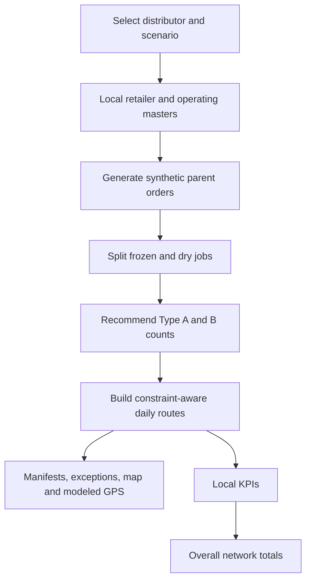

# DomTransport: module-by-module review notes

Use this as your rehearsal reference. Start with sections 1-3, then work through one retailer basket, one vehicle route and the network summary. The [core-change record](core-changes.md) explains why the product evolved; the [approach draft](approach-draft.md) contains the proposed production mathematical model.

Current extension: read [road routing and extended cost estimates](road-routing-and-costs.md). Road validation is optional per distributor; old tables below explicitly retain approximate-mode base transport for comparison.

## 1. Your opening explanation

"DomTransport separates fleet allocation from daily dispatch. For each distributor we estimate the refrigerated and dry workload, recommend vehicle counts, then test those vehicles against CBM, KG, receiving windows and shift return. We show missed and partial orders so leadership can assess service and cost together. All operational data in this demonstration is synthetic."

The business has about 50,000 mapped retailers. That is not a daily order count. The app starts with 100 synthetic profiles per distributor, or preserves existing Pasig edits. The normal fresh baseline is therefore 600 parent orders. Actual fleet acquisition requires historical demand, order frequency and local operating calibration.

## 2. What is built and what is proposed

| Area | Implemented | Proposed next step |
|---|---|---|
| Demand | Deterministic synthetic orders and larger peak baskets | Forecast distributor/SKU demand using supplied history and rolling backtests |
| Allocation | Integer workload heuristic with reserve | Evaluate fleet candidates across scenarios and full ownership/rental/service costs |
| Daily dispatch | Greedy, constraint-aware sequencing | Benchmark against a heterogeneous-fleet routing solver |
| Map/travel | Approximate baseline plus optional OSRM road geometry/durations and fixed-sequence feasibility validation | Truck-specific access validation and live/departure-dependent traffic |
| GPS | Schedule-based position interpolation | Actual telemetry and delivery events |
| AI assistance | Used to help develop code, documentation and tests | No runtime AI or forecasting service is currently connected |
| Deployment/data | Static Render configuration, browser-local settings and exports | Hosted smoke verification; shared storage only if scope later requires it |

## 3. How the modules connect



Editing the master changes the inputs; it does not directly force a desired KPI. Apply changes before switching workspaces. Temporary fleet overrides test a local dispatch scenario; the network summary uses saved current depot trucks.

## 4. Distributor workspaces and master data

Code: [network.js](../network.js), [RetailerManagement.tsx](../src/RetailerManagement.tsx), [Settings.tsx](../src/Settings.tsx).

Each distributor owns its depot, five traffic zones, retailer list/receiving hours, seed, peak factor, speed/detour, traffic multipliers, shift/ban, vehicle costs/capacities and product measurements/handling times. Initial values may match across distributors, but edits are independent. SKU categories and temperature segregation are shared rules.

The root `network` record contains six local configurations. Migration retains Pasig settings and resolves old receiving-hour edits before separating profiles by owner. IDs are unique across the network. Settings imports validate the complete replacement before saving; standalone retailer imports must match the selected distributor. Version-2 full settings exports contain all six masters; legacy version-1 settings migrate forward.

**Receiving status matters:** active/open profiles generate serviceable demand; closed profiles still generate orders and exceptions; archived profiles do not generate demand. Each active profile creates one parent order per modeled day. All schedules are same-day assumptions, not verified supplier receiving calendars.

Panel line: "A closed retailer is a service exception, not spare vehicle demand; an archived retailer is outside today's demo demand."

## 5. Synthetic demand and peak season

Code: `generateOrders` and `getRetailers` in [engine.js](../engine.js).

Each dry SKU starts with 0-3 boxes. Ice cream has a 28% inclusion probability and 1-3 boxes when included. An empty basket is repaired to one toothpaste box. A seeded random generator makes the scenario reproducible; this is an assumed demand distribution, not a learned one. The observed frozen-order percentage can differ from 28% in a finite sample.

For peak demand, each sampled SKU quantity is multiplied by its local peak factor and rounded up. Example: 3 boxes at 1.6 becomes `ceil(4.8) = 5`; 1 box becomes 2. The multiplier runs before empty-basket repair, so an all-zero basket still becomes one toothpaste box. Consequently total growth may exceed 60%. Retailer count and master receiving windows stay fixed; increased peak order frequency is not modeled.

Changing a seed, replacing/reordering profiles or changing packaging can change results. Archiving retains random-number consumption for other profiles so it does not reshuffle their baskets.

## 6. Product boxes, CBM and KG

Code: `generateOrders`, `splitOrders`, and the product box master.

```text
Order CBM = sum(boxes of SKU p * CBM per box p)
Order KG  = sum(boxes of SKU p * KG per box p)
```

Quantity remains boxes. CBM and KG are two separate capacity measures. Default per-box assumptions:

| SKU | CBM | KG | Load min/box | Unload min/box |
|---|---:|---:|---:|---:|
| Toothpaste | 0.035 | 12 | 0.2 | 1 |
| Ice cream | 0.090 | 18 | 0.5 | 2 |
| Soap | 0.050 | 16 | 0.2 | 1 |
| Water purifier | 0.220 | 25 | 1 | 5 |
| Tea | 0.040 | 8 | 0.2 | 1 |

**Worked basket:** 2 toothpaste + 1 ice cream + 3 soap + 1 water purifier + 2 tea boxes totals **0.610 CBM and 131 KG**. Its frozen portion is 0.090 CBM / 18 KG, and dry portion is 0.520 CBM / 113 KG. Measurements are editable assumptions, not manufacturer specifications. CBM means cubic metres, so replacing the old unit label does not change the underlying volume.

## 7. Frozen/dry segregation, multi-drop routes and order completion

Code: `splitOrders` and `plan` in [engine.js](../engine.js).

Ice cream becomes a frozen job for Type A. The other SKUs become a dry job for Type B. A mixed parent order creates two jobs at the same retailer with the same receiving interval. Each job is indivisible; the planner does not distribute one temperature-specific job across several vehicles.

Vehicles consolidate compatible jobs from multiple retailers into a multi-drop depot tour. Frozen and dry goods are not co-loaded in the same vehicle under the selected policy. That segregation was an explicit user choice: the brief itself says ice cream needs Type A, but does not explicitly require dry products to be banned from Type A.

One job assigned from a two-job order means **partial**, not complete. Parent coverage and delivery visit counts therefore differ. The fresh Pasig baseline has 100 parents and 125 jobs. Two visits to a retailer count as two drops, but at most one complete parent order.

## 8. Loading, unloading and receiving windows

```text
Job service minutes = fixed handling per stop
                    + sum(job boxes * (load min/box + unload min/box))
```

The default fixed handling is 5 minutes. For the worked basket, the frozen job takes `5 + 1*(0.5+2) = 7.5` minutes. The dry job takes `5 + 2*1.2 + 3*1.2 + 1*6 + 2*1.2 = 19.4` minutes. Two jobs incur fixed handling twice; total handling is 26.9 minutes.

Both per-box load and unload time are conservatively charged inside stop handling. This is a time-budget proxy; actual warehouse loading is not separately simulated. Fixed depot preparation is another 25 minutes before departure, not a per-box warehouse scheduling model.

```text
Service start  = max(estimated arrival, receiving opens)
Service finish = service start + job service minutes
Require service finish <= receiving closes
```

Example: arrival 9:20 AM PHT, receiving opens 9:30 AM and service takes 19.4 minutes. Start is 9:30 AM, finish is 9:49:24 AM. A 9:45 AM close makes it infeasible even though the vehicle arrived early. UI clock displays round down to the minute; feasibility uses full numeric precision.

No dock-contention constraint prevents the two vehicles from servicing the same retailer simultaneously in the model. Weekly schedules, lunch breaks and multiple receiving intervals are not implemented.

## 9. Fleet allocation calculation

Code: `allocate` in [engine.js](../engine.js).

Calculate frozen and dry workloads separately, excluding jobs for closed retailers from serviceable fleet demand:

```text
Available hours per vehicle = (shift end - shift start - depot preparation) / 60
Estimated workload hours = sum(service minutes / 60
  + 2.4 KM * detour / speed * network traffic factor * destination zone factor)

Vehicles = ceil((1 + reserve) * max(
  total CBM / vehicle CBM capacity,
  total KG / vehicle KG capacity,
  estimated workload hours / available hours))
```

An empty class gets zero vehicles. Reserve defaults to 15%; the form displays 15, internally stored as 0.15. The 2.4 KM nominal leg is a workload assumption, not calculated route mileage. Allocation does not directly include truck-ban waiting, exact depot geography or clustered receiving windows. Routing checks those modeled conditions afterward.

**Actual fresh Pasig normal calculation:** shift 6:00 AM-6:00 PM minus 25 minutes gives 11.5833 available hours. Type A capacity is 5 CBM / 900 KG; Type B is 11 CBM / 2,500 KG.

| Class | Jobs | Total CBM | Total KG | Workload hours | CBM ratio | KG ratio | Time ratio | Recommendation |
|---|---:|---:|---:|---:|---:|---:|---:|---:|
| Frozen / A | 25 | 4.590 | 918 | 10.8886 | 0.9180 | 1.0200 | 0.9400 | ceil(1.15 * 1.0200) = 2 |
| Dry / B | 100 | 50.535 | 9,084 | 58.8726 | 4.5941 | 3.6336 | 5.0825 | ceil(1.15 * 5.0825) = 6 |

Weight binds the frozen estimate; time binds dry. Counts are integer recommendations, not guaranteed feasible routes or a cost-optimal mix. Costs are evaluated afterward; allocation does not choose between A/B based on marginal cost under this fixed segregation policy.

Panel line: "We size against the binding resource, then validate the suggested fleet against the actual modeled day."

## 10. Approximate travel and Philippine truck-ban time

Code: `distance` and `travel` in [engine.js](../engine.js); [PHT helpers](../src/ph-conventions.js).

```text
Leg KM = haversine straight-line KM * detour factor
Travel minutes = Leg KM / base speed * 60 * network traffic factor * destination zone factor
```

Depot-return travel uses only the network factor because the depot has no destination traffic-zone index. Factors multiply time, not the distance used for distance-based cost.

Illustrative Pasig example: a 5 KM straight-line leg becomes 6.75 KM at detour 1.35. At 22 KM/h, network factor 1.35 and destination factor 1.65, travel is about **41.0 minutes**. These values estimate a leg; they are not measured congestion or road directions.

The default illustrative Type B ban is 7:00-9:00 AM PHT. If an affected trip would overlap that interval, the vehicle waits at its origin until 9:00 AM before moving. For example, a 6:40 AM departure with a 41-minute trip waits until 9:00 AM; arrival is about 9:41 AM. A trip finishing exactly at 7:00 AM does not overlap; a 9:00 AM departure is permitted. The same rule applies to return legs.

This is a blanket no-movement assumption. It does not identify restricted roads, enforce actual MMDA/LGU rules or handle exemptions. Clocks use Philippine wall time regardless of the browser timezone. Internally 7:00 AM is minute 420; it is not a UTC timestamp. Midnight in shift/ban end inputs means end of that day; overnight shift intervals are not supported.

## 11. Daily dispatch sequencing

Code: `plan` in [engine.js](../engine.js).

1. Split orders into jobs and process Type A, then Type B.
2. Start each vehicle at its own depot after preparation; inspect pending compatible jobs.
3. Reject closed retailers and jobs that exceed remaining CBM or KG.
4. Estimate travel, restriction wait, receiving wait and full service finish.
5. Reject a job if service misses its close, or a direct modeled return would miss shift end.
6. Choose the feasible candidate with the lowest score, append it, update load/time and repeat.
7. Return to the depot; leave remaining jobs and incomplete parents visible.

```text
Candidate score = 3 * leg KM + 0.12 * receiving-wait minutes
                + 0.012 * (receiving close - shift start)
```

Lower scores favor short legs, less waiting and earlier closing times. Coefficients are assumed ranking weights, not PHP, trained parameters or proof of optimality. The sequence is deterministic and greedy. There is one tour per vehicle, no reload, driver breaks, inter-depot vehicle sharing or route-improvement search.

Exception labels distinguish closed receiving, service too long, compatible capacity excess and a general fleet/window/shift failure. They are diagnostic categories, not a solver's proof of the exact binding constraint. More trucks may not solve a job that exceeds one vehicle's capacity or has an impossible receiving window.

## 12. KPIs and their denominators

Code: `plan`, `summarizeNetwork` and [NetworkOverview.tsx](../src/NetworkOverview.tsx).

| KPI | Calculation | Interpretation |
|---|---|---|
| Vehicles used | Routes containing at least one assigned job | Allocated but unused vehicles are excluded |
| Complete-order coverage | Complete parent orders / all parent orders | Partial mixed orders count incomplete |
| Planned window compliance | Assigned jobs finishing by close / assigned jobs | Usually 100% because infeasible jobs are rejected; not actual on-time delivery |
| CBM utilization | Mean(route CBM / its vehicle CBM capacity) over used vehicles | An average of vehicle ratios, not pooled CBM / pooled capacity; inspect KG and time too |
| Average drops | Assigned jobs / used vehicles | Frozen/dry visits count separately; depot legs, idle trucks and unassigned jobs excluded |
| Distance | Sum of legs including depot returns | OSRM road KM in road mode; detoured estimates in approximate mode |
| Base transport | Sum(used vehicle daily charge + route KM * its PHP/KM) | Preserved in legacy cost field; operating estimate adds editable idle, maintenance, toll and overtime allowances |
| Risk / opportunity | Expected frozen spoilage + unassigned contribution margin | Separate from operating costs; see the extended-cost guide |

Zero denominators produce zero. At network level, sum numerators and denominators before calculating coverage or average drops. For network CBM utilization, weight each local mean by its used vehicles. Do not simply average six distributor percentages.

**Reference approximate-mode results with each scenario's recommended fleet (base transport cost):** Peak rows try the larger recommended peak fleet; the app now defaults to saved current trucks and does not automatically expand inventory. results change with saved edits; these figures do not describe every user's browser state.

| Scenario | Parent orders complete | Allocated / used vehicles | Estimated KM | Modeled cost | Average drops |
|---|---:|---:|---:|---:|---:|
| Pasig normal | 93 / 100 | 8 / 8 | 164.9 | PHP 14,893 | 118 / 8 = 14.75 (14.8 displayed) |
| Pasig peak | 100 / 100 | 13 / 12 | 185.0 | PHP 20,736 | 125 / 12 = 10.4 displayed |
| Six-distributor normal | 545 / 600 | 54 / 53 | 1,319.9 | PHP 102,581 | 725 / 53 = 13.7 displayed |
| Six-distributor peak | 578 / 600 | 82 / 80 | 1,756.2 | PHP 149,296 | 759 / 80 = 9.5 displayed |

More peak vehicles can improve coverage despite bigger baskets; this is not evidence that peak operations are inherently easier. Unused vehicles can coexist with missed jobs because timing, compatibility and heuristic sequencing still constrain service.

## 13. Map, manifests and modeled GPS

Code: [MapView.tsx](../src/MapView.tsx), `positionAt` in [engine.js](../engine.js), manifest UI in [App.tsx](../src/App.tsx).

MapLibre displays OSRM road geometry after road validation, or labeled straight connections in approximate mode, assigned stops, red incomplete-order markers and the selected depot. A partial parent can therefore appear as an exception at a location that also has an assigned stop. Red is an incomplete plan marker, not an actual failed delivery event.

The manifest is the numerical route record: sequence, products, receiving window, service start/finish, waits, CBM/KG, cost and return time. GPS playback interpolates along road geometry in road mode and between scheduled coordinates in approximate mode, waits during restrictions/receiving/handling, and returns to that route's depot. Playback offers Slow/Demo/Fast speeds with smaller time steps; roads are preferred and approximate playback requires an explicit choice. It is not live tracking, a drivable-road guarantee or cold-chain temperature monitoring.

## 14. Persistence, public references and hosting

Code: [App.tsx](../src/App.tsx), `validateConfig`/`importRetailerMaster`, [render.yaml](../render.yaml).

Applied settings save to localStorage in the current browser and origin. Full settings exports move all six masters; standalone retailer files move one matching master; plan files are review snapshots and cannot be imported as settings. Wrong-region masters, duplicate network IDs and malformed values are rejected. Applying settings recomputes plans; it does not update real deliveries.

The public branch/address catalog is separate from synthetic operational data. It has no asserted receiving windows or verified geocodes and cannot be imported as a dispatch master.

Render's static-site configuration runs `npm ci && npm test && npm run build` and publishes `dist`. Source is published on GitHub. Render deployment and hosted smoke verification remain outstanding in this session. Browser-local JSON remains usable on static hosting; localhost settings must be exported/imported because the hosted URL has a different origin. There is no shared server database.

## 15. How to defend and review the prototype

| Panel question | Answer to rehearse |
|---|---|
| Why only 600 sample orders? | The brief permits about 100 for one distributor; we extended that sample to six. It demonstrates logic without pretending the 50,000-retailer footprint is daily demand |
| Why not five years of sample history? | No history was supplied. We explain the forecasting/backtesting approach and use synthetic daily scenarios; a fabricated history would not validate actual demand |
| Is 100% on-time credible? | It is assigned-job planning compliance. Rejected jobs remain in coverage and exception metrics; actual execution needs delivery confirmations |
| Is the solution optimal? | No. Workload sizing and greedy sequencing provide a transparent starting point for solver benchmarking and field validation |
| Why separate frozen and dry? | It is our declared operating policy; real co-loading would need validated temperature/packaging compatibility |
| How do you respond to demand shifts? | Replan daily, review forecasts weekly, review fleet monthly and before peak. Illustrative triggers include sustained demand drift, low coverage or prolonged high/low utilization |
| What would production need? | Real demand/mapping, validated receiving schedules/geocodes, travel and restriction data, temperature controls, calibrated costs, solver comparison and dispatcher pilot |

Rehearsal: open Network overview; select Pasig; explain one mixed basket and its two jobs; inspect A/B manifests; reduce the fleet to expose misses; restore; edit one receiving window or traffic factor; compare another distributor's unchanged master; finish with network totals and limitations. Export settings before experiments so your exact demo state can be restored.

Evidence: 58 automated checks and production build passed at the latest code milestone. Server-rendering smoke passed; browser interaction/map visual QA and Render verification remain outstanding. [Verification record](verification.md) lists the limits. Do not describe the demo as live GPS, trained AI forecasting, legal truck-ban enforcement, proven optimization or verified savings.


Current demand/inventory controls are in [Depot planning](depot-planning.md). Daily demand can select fewer active profiles without deleting them; current trucks are saved separately from normal/peak recommendations. Earlier numeric peak examples that allocate the recommended peak fleet are recommendation experiments, not the default current-fleet plan.

### Reading the manifest timing columns

Each stop shows driving, wait for store, truck-ban wait, loading allowance, unloading, fixed stop tasks and total handling as separate minute columns. Store wait is early arrival before receiving opens; truck-ban wait happens at the previous location before travel. Neither is included in handling. For example, `89.7 store + 0.0 ban` means about 1 hour 30 minutes waiting for receiving, with no restriction wait. `7.5 handling` is `0.5 loading allowance + 2.0 unloading + 5.0 stop tasks`. These are modeled allowances, not measured operating times. The loading allowance is conservatively charged at the stop; actual warehouse loading is not separately simulated.
